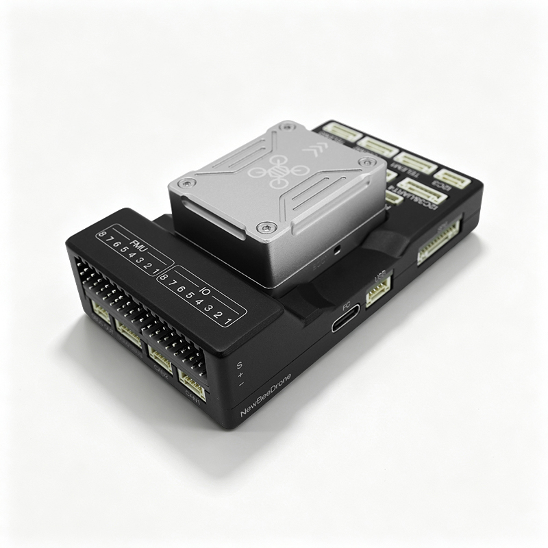
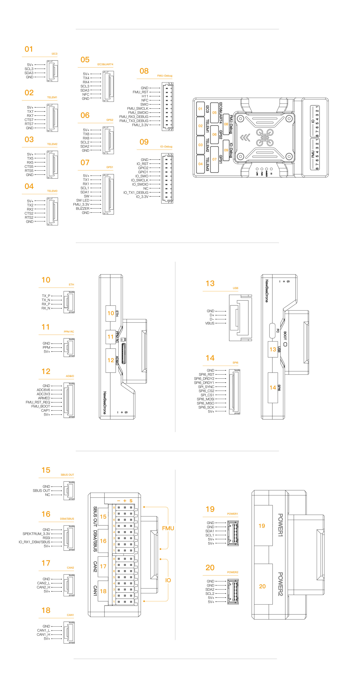
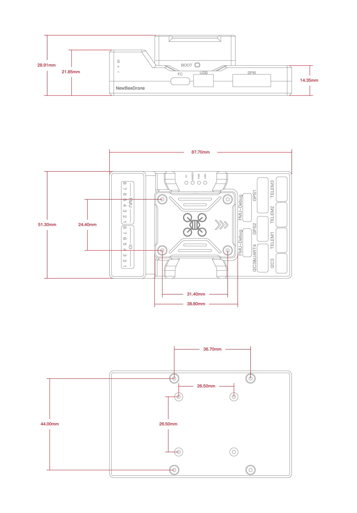

# NewBeeDrone PixNova

::: warning
PX4 does not manufacture this (or any) autopilot.
Contact [NewBeeDrone](https://newbeedrone.com/) for hardware support or compliance issues.
:::



::: info
This flight controller is [manufacturer supported](../flight_controller/autopilot_manufacturer_supported.md).
:::

## Introduction

The NewBeeDrone PixNova is a professional, modular flight controller designed for high performance.
It combines an STM32H753 main processor with an independent I/O processor, redundant IMUs, and a heating system that maintains the IMU temperature.
It is designed for multirotors, fixed-wing aircraft, and other unmanned systems that require high reliability.
The I/O baseboard provides a broad set of interfaces for connecting external peripherals.

## Key Design Points

- STM32H753 main processor with a separate STM32F103 I/O processor.
- Three ICM-45686 IMUs, two barometers, and a BMM150 magnetometer.
- IMU heating resistors to maintain sensor temperature and reduce temperature-related drift.
- Redundant power inputs with automatic source selection in the order `POWER1` > `POWER2` > USB.
- ESD protection on the external interfaces, with overvoltage and undervoltage protection on the baseboard.
- A 100 Mbps Ethernet interface for communicating with companion computers using MAVLink and applications such as MAVROS.
- Two CAN buses for DroneCAN/UAVCAN peripherals, including ESCs that report RPM, voltage, and current.
- Two GPS ports, external I2C and SPI connections, and 16 PWM outputs.
- A microSD card slot for [flight logging](../dev_log/logging.md).

## Technical Specifications

### Processors

- FMU processor: STM32H753IIK6
  - 32-bit Arm Cortex-M7, 480 MHz
  - 2 MB flash memory, 1 MB RAM
- I/O processor: STM32F103
  - 32-bit Arm Cortex-M3

### Sensors

| Location  | Component      | Model             |
| --------- | -------------- | ----------------- |
| FMU board | IMU            | 1 × TDK ICM-45686 |
| FMU board | Barometer      | ICP-20100         |
| IMU board | Redundant IMUs | 2 × TDK ICM-45686 |
| IMU board | Barometer      | BMP388            |
| IMU board | Magnetometer   | BMM150            |

The IMU board includes heating resistors to maintain sensor temperature in cold conditions.

### Interfaces

- 16 PWM outputs: 8 FMU and 8 I/O outputs
- 3 telemetry ports with RTS/CTS hardware flow control
- 2 GPS ports, including safety switch and buzzer signals on `GPS1`
- 1 UART4 port sharing a connector with I2C3
- 2 CAN buses
- 1 Ethernet port, 100 Mbps
- External I2C and SPI6 connections
- PPM and DSM/SBUS receiver inputs, RSSI input, and SBUS output
- USB Type-C and GH USB extension connectors
- 2 power module inputs
- Analogue and digital I/O, including ADC inputs labelled 3.3 V and 6.6 V
- FMU and I/O debug ports
- microSD card slot

### Operating Temperature

- −20 to +85 °C

## Where To Buy {#store}

Contact [NewBeeDrone](https://newbeedrone.com/) for PixNova availability and ordering information.

## Assembly And Setup

1. [Mount and orient the flight controller](../assembly/mount_and_orient_controller.md) on the vehicle.
2. Connect a suitable power module to `POWER1`, and connect an optional backup power module to `POWER2`.
3. Connect the GPS, receiver, telemetry equipment, and actuators using the [pinout diagram](#pinouts).
4. [Install PX4 firmware](../config/firmware.md) using _QGroundControl_.
5. Complete the [basic configuration](../config/index.md), including airframe selection, sensor calibration, radio setup, and actuator configuration.

## Pinouts

The numbered connectors in the diagram correspond to the table below.



| No. | Connector        | Function                                                                           |
| --- | ---------------- | ---------------------------------------------------------------------------------- |
| 01  | `I2C3`           | External compass, optical flow, or range sensor; 5 V, SCL3, SDA3, and GND          |
| 02  | `TELEM1`         | Primary telemetry port on UART7, with RTS/CTS flow control                         |
| 03  | `TELEM2`         | Secondary telemetry or companion computer port on UART5, with RTS/CTS flow control |
| 04  | `TELEM3`         | Additional telemetry port on USART2, with RTS/CTS flow control                     |
| 05  | `I2C3 & UART4`   | Shared connector exposing I2C3 and UART4 for external sensors or a serial receiver |
| 06  | `GPS2`           | Secondary GPS port with UART8 and I2C2                                             |
| 07  | `GPS1`           | Primary GPS port with USART1, I2C1, safety switch, and buzzer signals              |
| 08  | `FMU-Debug`      | FMU SWD debug interface and USART3 serial console                                  |
| 09  | `IO-Debug`       | I/O processor SWD debug interface                                                  |
| 10  | `ETH`            | Ethernet interface with TX+/TX− and RX+/RX− pairs                                  |
| 11  | `PPM RC`         | PPM receiver input                                                                 |
| 12  | `AD & I/O`       | Analogue and digital I/O, including ADC inputs labelled 3.3 V and 6.6 V            |
| 13  | `USB`            | USB extension connector                                                            |
| 14  | `SPI6`           | External SPI connection for sensors or other peripherals                           |
| 15  | `SBUS OUT`       | SBUS output connection                                                             |
| 16  | `DSM/SBUS`       | DSM/Spektrum or SBUS receiver input, with RSSI input                               |
| 17  | `CAN2`           | Second DroneCAN/UAVCAN bus                                                         |
| 18  | `CAN1`           | First DroneCAN/UAVCAN bus                                                          |
| 19  | `POWER1`         | Primary power module input                                                         |
| 20  | `POWER2`         | Backup power module input                                                          |
| 21  | `FMU/IO`         | 16 PWM outputs: 8 FMU and 8 I/O outputs                                            |
| 22  | USB Type-C       | USB connection for firmware installation and configuration                         |
| 23  | GH USB extension | Connection for an external USB extension board                                     |
| 24  | microSD          | Card slot for flight logs                                                          |

Connectors 21–24 are listed in the manufacturer's interface specifications; the numbered pinout drawing covers connectors 01–20.

## Serial Port Mapping

The mapping below follows the PixNova PX4 board configuration.
See [Serial Port Configuration](../peripherals/serial_configuration.md) to assign a peripheral to an available port.

| UART   | PX4 Device   | Connection                        |
| ------ | ------------ | --------------------------------- |
| USART1 | `/dev/ttyS0` | `GPS1`                            |
| USART2 | `/dev/ttyS1` | `TELEM3`                          |
| USART3 | `/dev/ttyS2` | FMU serial console on `FMU-Debug` |
| UART4  | `/dev/ttyS3` | `I2C3 & UART4`                    |
| UART5  | `/dev/ttyS4` | `TELEM2`                          |
| USART6 | `/dev/ttyS5` | Internal FMU-to-PX4IO connection  |
| UART7  | `/dev/ttyS6` | `TELEM1`                          |
| UART8  | `/dev/ttyS7` | `GPS2`                            |

USART6 connects the FMU to the I/O processor and is not an external peripheral UART.

## PWM Outputs And RC Input

The baseboard provides 16 PWM outputs, split into 8 FMU outputs and 8 I/O outputs.
Configure the output functions using [Actuator Configuration](../config/actuators.md).

Connect a PPM receiver to `PPM RC`, or a compatible SBUS/DSM/Spektrum receiver to `DSM/SBUS`.
CRSF receivers, including compatible ExpressLRS receivers, use a spare UART such as `UART4`.
Follow [CRSF Telemetry](../telemetry/crsf_telemetry.md) for wiring and the required PX4 firmware configuration.

## Voltage Ratings

### Input Ratings

| Input                | Manufacturer Rating |
| -------------------- | ------------------- |
| `POWER1` / `POWER2`  | 3.8–5.8 V           |
| USB                  | 4.75–5.25 V         |
| PWM/servo power rail | 0–12 V              |

The PWM/servo rail rating is separate from the flight controller supply rating.
Select a rail voltage that matches the connected actuators; the 12 V rating does not apply to the PWM signal pins.

### Power Protection

The board automatically selects the available power source in the order `POWER1` > `POWER2` > USB.
The baseboard provides overvoltage protection at 5.85 V and undervoltage protection at 3.81 V.

`TELEM1` and `GPS2` share a 1.5 A peripheral current limit.
The remaining expansion interfaces share a separate 1.5 A current limit.

## Dimensions

The overall dimensions are 87.70 × 51.30 × 28.91 mm, as shown in the manufacturer's drawing.
The drawing also gives the mounting-hole positions and spacing in millimetres.



## Peripherals

### Ethernet

The `ETH` connector provides a 100 Mbps Ethernet interface using two differential pairs.
Use [PX4 Ethernet Setup](../advanced_config/ethernet_setup.md) to configure a connection to a companion computer or ground station.

The PixNova PX4 board configuration enables MAVLink over Ethernet by default.
External devices can also connect through the telemetry, GPS, I2C, SPI, and CAN ports.
See [DroneCAN](../dronecan/index.md) for CAN peripheral setup and [Companion Computers](../companion_computer/index.md) for companion computer integration.

## Building Firmware

To [build PX4](../dev_setup/building_px4.md) for this target from source:

```sh
make newbeedrone_pixnova_default
```

Install the resulting `.px4` file using the [custom firmware option](../config/firmware.md#custom) in _QGroundControl_.

## Debug Port {#debug_port}

The `FMU-Debug` connector exposes the [SWD interface](../debug/swd_debug.md) and the [PX4 System Console](../debug/system_console.md) on USART3.
The PX4 console is configured for 57600 baud.
The separate `IO-Debug` connector exposes SWD for the I/O processor.

Refer to the pinout diagram for the debug connector signal order.

## Supported Platforms / Airframes

PixNova is designed for multicopter, fixed-wing, and other unmanned vehicle applications.
See the [Airframes Reference](../airframes/airframe_reference.md) for PX4 airframe configurations.

## More Information

- [NewBeeDrone](https://newbeedrone.com/) — manufacturer and hardware support.
- [Basic Configuration](../config/index.md).
- [Flight Controller Orientation](../config/flight_controller_orientation.md).
- [Flight Logging](../dev_log/logging.md).
